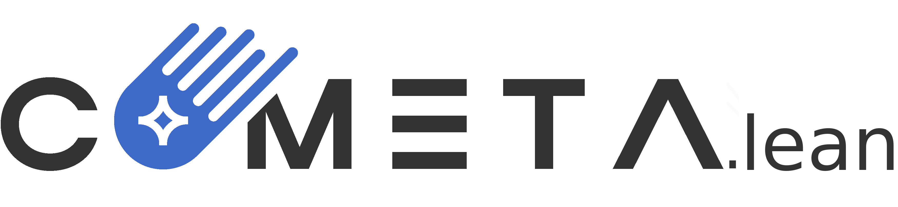

<!--
Copyright 2026 Biglup Labs
SPDX-License-Identifier: Apache-2.0

Licensed under the Apache License, Version 2.0 (the "License");
you may not use this file except in compliance with the License.
You may obtain a copy of the License at

    https://www.apache.org/licenses/LICENSE-2.0

Unless required by applicable law or agreed to in writing, software
distributed under the License is distributed on an "AS IS" BASIS,
WITHOUT WARRANTIES OR CONDITIONS OF ANY KIND, either express or implied.
See the License for the specific language governing permissions and
limitations under the License.
-->

<div align="center">
  <a href="https://cometa.dev/" target="_blank">
    
  </a>
</div>

<br>

<div align="center">


[](https://x.com/BiglupLabs)

</div>

<hr>

# Cometa.lean

Native Cardano transaction construction and inspection for Lean 4.
The native adapter uses cardano-c **2.0.0-rc.7**; the toolchain is pinned to
**Lean 4.36.0**.

The API constructs multi-asset outputs, native and versioned Plutus scripts, and
Plutus data. It now constructs checked input sets, UTxOs, core transaction bodies,
reward accounts, withdrawal maps, metadata, auxiliary data, and unsigned transactions
through cardano-c. Wallets, remaining advanced body
and witness APIs, balancing, signing, and submission are still being implemented. Proofs describe the Lean models and
checked results; they do not verify all cardano-c or ledger execution.

## Build

Install the pinned Lean toolchain with Elan, Python 3.12+, and a C11 compiler.
Linux x86_64 requires glibc 2.33 or newer.

```sh
lake build
lake test
```

Lake prepares the native dependency automatically, including when Cometa is used
from another package. Downloads are version-pinned and SHA256-checked; subsequent
builds verify and reuse the local installation. See the
[development guide](docs/development.md) for offline setup, platform scope,
independent-consumer checks, memory checks, and API documentation generation.

## Examples

| Program | Workflow |
| --- | --- |
| [InspectAddress.lean](Examples/InspectAddress.lean) | Parse a recipient and amount, then construct an ordered payment plan. |
| [InspectTransaction.lean](Examples/InspectTransaction.lean) | Read transaction CBOR, calculate its ID, and inspect its fee, inputs, and output summaries. |
| [BuildOutput.lean](Examples/BuildOutput.lean) | Construct a multi-asset output, check its encoding through C, and decode its assets, inline datum and reference script. |
| [BuildTransaction.lean](Examples/BuildTransaction.lean) | Read a supplied UTxO, create payment and change outputs, and assemble an unsigned transaction with explicit fee and validity. |
| [BuildMetadataTransaction.lean](Examples/BuildMetadataTransaction.lean) | Build labeled metadata, commit its native hash, and attach the exact payload to an unsigned transaction. |
| [WithdrawRewards.lean](Examples/WithdrawRewards.lean) | Add a reward withdrawal to a supplied UTxO and return the combined value, less an explicit fee, in an unsigned transaction. |

All are complete single-file programs. Construction examples produce unsigned
transactions; signing and submission are not yet implemented.

### Inspect an address

[InspectAddress.lean](Examples/InspectAddress.lean) contains the complete program,
including argument validation and error reporting:

```sh
lake exe inspectAddress \
  addr_test1vz2fxv2umyhttkxyxp8x0dlpdt3k6cwng5pxj3jhsydzerspjrlsz \
  2000000
```

Address parsing returns `EIO Error Address`. Amount validation and payment
construction return `Except Error ...`; combine that pure validation before
lifting it once into the effectful workflow. Parsed addresses are ordinary
Lean-owned values, with no native handles for callers to release.

`Plan.payTo` constructs a single-payment plan; `++` appends plans while retaining
order and duplicate payments. `Plan.totalLovelace_append` proves that composition
adds their requested lovelace totals. These totals exclude fees and deposits.

### Inspect a transaction

Run the example with the included synthetic, unsigned transaction:

```sh
lake exe inspectTransaction Examples/transaction.cbor.hex
```

It prints the transaction ID, declared fee and script-validity flag, spending
inputs, and each ordinary output's address and lovelace component. The fixture
spends a nonexistent input; it is for offline inspection, not submission.

The library API keeps the effectful parsing step separate from pure observations:

```lean
def inspect (cborHex : String) : EIO Cometa.Error String := do
  let transaction ← Cometa.Transaction.ofHex cborHex

  let identifier := transaction.id
  let fee := transaction.fee
  return s!"{identifier}: {fee} lovelace in fees"
```

`Transaction.toCbor` preserves every supplied byte, including body encoding,
witnesses, and outer framing. Output summaries retain complete native-reserialized
CBOR through `output.toCbor`; their `lovelace` field is only the ada component.
Parsing does not validate signatures, scripts, balances, or ledger acceptance.

### Construct a multi-asset output

```sh
lake exe buildOutput \
  addr_test1vz2fxv2umyhttkxyxp8x0dlpdt3k6cwng5pxj3jhsydzerspjrlsz \
  11111111111111111111111111111111111111111111111111111111 \
  616263 1 2000000
```

This constructs an output holding 2 ADA and one unit of asset name `abc` under the
supplied synthetic policy. It attaches constructor data and a native timelock
reference script. It does not mint that asset or submit a transaction.

`Value` supports exact signed addition, subtraction, and scaling. Duplicate assets
add and zero totals disappear when inspecting or encoding the bundle. An output
must pass `Value.checkOutput`; mint/burn serialization uses separate signed bounds.
`Output.create` accepts all three datum forms and an optional reference script.
It returns `EIO Error Output`: cardano-c constructs the output and writes its CBOR.

`Script.ofNative` covers signatures, all/any/threshold combinations, and validity
bounds, and require-guard credentials. `Script.ofPlutus` supports V1 through V4 as opaque compiled programs, with
native-computed hashes. `PlutusData` covers constructors, ordered maps/lists,
arbitrary integers, and bytes; imported datum encodings retain their identity.
Language support does not imply activation on a particular network.

`Value.quantity_add` proves per-asset conservation under addition, and
`Value.checkOutput_sound` proves the validator's quantity guarantee.
`Output.checkNativeEncoding` runs the real C codec and returns bytes with evidence
of equality to this output's cached native encoding. That evidence is specific to the
checked result, not a universal proof of the C serializer.

## Documentation and conventions

Public definitions document their units, bounds, errors, and effects in Lean doc
comments. [CODING_CONVENTIONS.md](CODING_CONVENTIONS.md) describes layout, section
separators, validation, FFI ownership, and proof boundaries. The
[development guide](docs/development.md#api-documentation) explains how to build
the doc-gen4 reference locally.

The [implementation plan](docs/implementation-plan.md) records this milestone
and the remaining work toward complete transaction assembly, wallets, providers, and a
complete build/sign/submit workflow. The [coverage contract](docs/api-coverage.md)
requires full transaction-building parity, replaceable providers/evaluators/coin
selectors, and direct access to native instances with explicit proof boundaries.

Licensed under [Apache-2.0](LICENSE).

Release archives and the manual publication workflow are described in
[Releasing](docs/releasing.md). Reservoir indexes the GitHub repository; there is
no separate package upload to Reservoir.

### Inspect complete output fields

`Output.ofCbor` decodes legacy arrays and map outputs into checked addresses,
asset quantities, datum forms, and reference scripts. Use `EncodedOutput` when
the original representation must survive inspection:

```lean
def inspectOutput (bytes : ByteArray) : IO Unit := do
  let encoded ← (EncodedOutput.ofCbor bytes).toIO (IO.userError ∘ toString)
  let output := encoded.toOutput

  IO.println s!"Recipient: {output.address}"
  for (asset, quantity) in output.value.val.toList do
    IO.println s!"{asset}: {quantity}"

  if let some script := output.referenceScript then
    IO.println s!"Reference script: {script.hash.toHex}"
  IO.println s!"Original CBOR: {Hex.ofBytes encoded.toCbor}"
```

`encoded.toCbor` returns the exact imported bytes; `output.toCbor` produces a
cached map encoding produced by the native writer. `Script.ofCbor` and `EncodedPlutusData.ofCbor` likewise retain
imported bytes and their native-computed hashes while exposing `view` and
`toData`. Native-backed semantic decoders return `EIO Error` through `Value.ofOutputCbor`,
`Value.ofMintCbor`, `NativeScript.ofCbor`, and `PlutusData.ofCbor`.
These checks validate component structure and representable bounds, not ledger
acceptance. Native scripts include all seven pinned alternatives, including
Dijkstra require-guard scripts; availability still depends on the target era.

### Native implementation and Lean proofs

Parsing and serialization use cardano-c constructors, readers, getters, and
writers for credentials, values, mint maps, Plutus data, scripts, and outputs.
Lean owns copied snapshots and checks their public invariants; there is no Lean
CBOR encoder or decoder. `PlutusData.toCbor`, `NativeScript.toCbor`,
`Credential.toCbor`, and value codecs expose native effects through `EIO`.
Byte accessors on already encoded objects simply return cached bytes.

`Value` arithmetic and `Plan` composition are pure specification/convenience
models. Their theorems describe those models and executable validators, not the
native algorithms. Native parsing is not ledger validation: the pinned datum
reader accepts oversized byte leaves, and its multi-asset reader coalesces
repeated policy maps. Imported encoded wrappers retain the supplied bytes.

## Assemble an unsigned transaction

The single-file example uses a synthetic 5 ADA UTxO fixture and the native input,
output, body, and transaction constructors:

```sh
lake exe buildTransaction Examples/utxo.cbor.hex \
  addr_test1vz2fxv2umyhttkxyxp8x0dlpdt3k6cwng5pxj3jhsydzerspjrlsz \
  2000000 170000 100000000
```

It prints an unsigned transaction containing the payment and change. The fixture
is offline and does not identify a real spendable output. Fee, validity, minimum
ada, UTxO freshness, script evaluation and witnesses must be handled before a
transaction can be submitted.

`TransactionBody.create` exposes explicit fee/validity, signed minting, auxiliary
and script-data hashes, collateral and return/total, reference inputs, key/script
guards, reward withdrawals, network, treasury value and donation. Native code performs construction,
serialization and inspection. `Transaction.ofBody` creates an empty native witness
set and assembles the transaction while retaining the original body encoding.

`InputSet` checks uniqueness of the actual native result. `checkDisjoint` returns
evidence about two observed sets; the caller chooses when an era/workflow requires
that relationship. `UTxO` pairs a reference with a complete resolved output without
asserting that it is unspent on chain.

Imported bodies preserve all bytes, including fields not yet covered by typed
constructors. `hasAdditionalFields` reports those fields; `toConfig` refuses a
reconstruction that would drop them. Rebuilding modeled fields can still normalize
encodings. The native writer omits empty guards, so construction explicitly rejects
`guards := some []`; imported empty guards remain preserved during assembly.

### Reward withdrawals

Construct key or script reward accounts with `RewardAccount.create`, or parse an
existing Bech32 account with `RewardAccount.ofString`. `Withdrawals.ofList` binds
the native withdrawal map and rejects duplicate accounts. Zero withdrawals are
retained, which also permits the zero-amount script-withdrawal pattern.

```lean
let account ← RewardAccount.ofString rewardAddress
let amount ← EIO.ofExcept (Lovelace.ofNat 2000000)
let withdrawals ← Withdrawals.ofList [⟨account, amount⟩]

let body ← TransactionBody.create {
  inputs, outputs, fee
  withdrawals := some withdrawals
  invalidAfter := some 100000000 }
let transaction ← Transaction.ofBody body
```

The complete example includes input loading, output construction and error handling:

```sh
lake exe withdrawRewards Examples/utxo.cbor.hex \
  stake_test1uqehkck0lajq8gr28t9uxnuvgcqrc6070x3k9r8048z8y5gssrtvn \
  2000000 170000 100000000
```

It uses an explicit 2 ADA reward amount and returns 6.83 ADA from the synthetic
5 ADA input after the supplied fee. Actual rewards, registration, input freshness,
fees, witnesses and script execution must be resolved for a live transaction.
`Withdrawals.accounts_unique` proves uniqueness of the checked native snapshot;
it does not prove that the accounts have rewards or that withdrawal is authorized.

### Metadata and auxiliary data

`Metadatum` supports integers, binary leaves, UTF-8 text, ordered lists and maps.
`Metadata.ofList` checks unique UInt64 labels and the 64-byte byte/text leaf limit.
All CBOR construction and parsing use cardano-c.

```lean
let metadata ← Metadata.ofList [(674, .text "Hello from Lean")]
let auxiliary ← AuxiliaryData.create { metadata := some metadata }

let body ← TransactionBody.create {
  inputs, outputs, fee
  auxiliaryDataHash := some auxiliary.hash }
let transaction ← Transaction.withAuxiliaryData body auxiliary
```

Assembly rejects a missing or mismatched body commitment and checks that the
native result preserved the body ID and exact auxiliary payload. The complete
program reads a UTxO, builds its return output and handles errors:

```sh
lake exe buildMetadataTransaction Examples/utxo.cbor.hex \
  674 "Hello from Lean" 170000 100000000
```

`AuxiliaryData.Config` also accepts native scripts and Plutus V1–V4 programs,
keeping absent fields distinct from present empty collections. Auxiliary scripts
are payloads, not witnesses. `Transaction.auxiliaryData` inspects imported payloads;
`AuxiliaryData.checkCommitment` returns evidence of equality with a supplied hash.
These checks do not establish schema validity, script execution or ledger acceptance.
